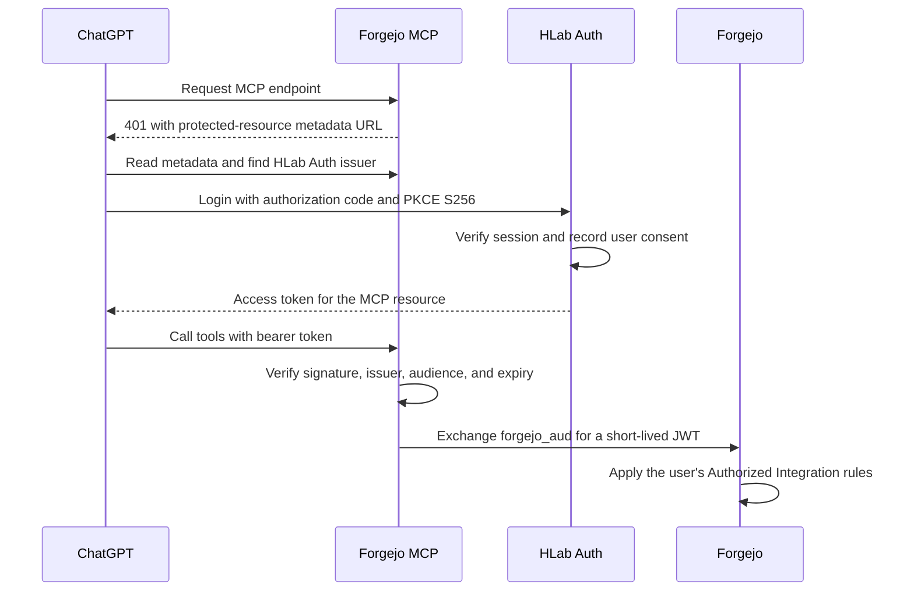

# Forgejo MCP OAuth runbook

This runbook covers the ChatGPT connection to `https://mcp.wayl.one/mcp`.
The current Argo deployment uses token passthrough. HLab Auth OIDC is disabled,
so the public OAuth discovery endpoints are not active yet.

## Request flow



## Current state

The public Forgejo MCP endpoint answers anonymous requests with `401`. The
protected-resource metadata endpoint currently answers `404`. HLab Auth's
OIDC discovery and JWKS endpoints also answer `404` because OIDC is disabled.
Do not configure ChatGPT until both services publish the OAuth metadata.

The live HLab Auth database is at migration `0008_route_auth_origin`. Revision
`0009_unique_app_route_hosts` must run before `0010_oidc_provider`. Test the
upgrade and downgrade on disposable PostgreSQL before applying either revision
to the live database.

On 2026-10-21, a disposable Longhorn restore of the latest HLab Auth volume
backup recovered PostgreSQL 17.2 at `0008_route_auth_origin`. The clone had 22
application tables, and `pg_amcheck` completed successfully. The restored
volume, PVC, PV, and test namespace were then removed. The backup target is
MinIO on Falcon3's `main` ZFS mirror. The separate 4 TB IronWolf `tank` mirror
does not currently hold this backup. This restore verifies the Longhorn copy;
production rollout remains gated on adding and testing an off-cluster copy.

## Rollout gates

Complete these gates before routing production MCP traffic through OAuth:

1. Merge and review the HLab Auth migration and theme fix.
2. Build and publish the reviewed HLab Auth image. Keep
   `HLAB_AUTH_OIDC_ENABLED=false` until its private signing key is mounted.
3. Confirm the Longhorn backup target is available. Restore a recent HLab Auth
   database volume to a new disposable volume and verify the restored data.
   Completed backup records alone do not prove a successful restore or an
   IronWolf mirror copy.
4. Apply migrations `0009` and `0010` through the approved HLab Auth rollout.
   Keep OIDC disabled while the migration runs.
5. Deploy the isolated `hlab-auth-oidc-stage` app at
   `auth-oidc-stage.wayl.one`. Mount its RSA signing key from a Sealed Secret.
   Set `HLAB_AUTH_OIDC_RESOURCE=https://mcp-oidc-stage.wayl.one/mcp` and verify
   provider discovery and JWKS over HTTPS. Its database is separate from the
   production database.
6. Deploy the separate `forgejo-mcp-oidc-stage` app at
   `mcp-oidc-stage.wayl.one`. Keep the production `/mcp` route on passthrough.
   Route only the final `/issuer` metadata and JWKS paths at `mcp.wayl.one` to
   the staging service so Forgejo can validate the issuer production will use.
7. Create a Forgejo Authorized Integration with the final issuer
   `https://mcp.wayl.one/issuer`, an exact `sub` claim rule, and read-only
   repository, issue, and user permissions. Do not grant write permissions.
   Copy its audience into the matching HLab Auth profile.
8. Register ChatGPT as a public OAuth client in HLab Auth. Use the exact
   callback URI shown by ChatGPT. In ChatGPT's advanced OAuth settings, select
   the manually configured client method and enter the returned client ID with
   no client secret. The ID is public, not a secret.
9. In staging, verify the Forgejo `sub` rule: a token with the configured
   subject and audience must succeed. A second test subject with the same
   audience must be denied. Do not weaken or remove the rule to run this test.
10. Complete a ChatGPT login, consent, token exchange, tool discovery, a
    read-only repository request, and a revocation check before cutover.

## Staging resource-server configuration

Use the v3.3.0 options shown below for the staging hostname after the HLab Auth
issuer and signing keys are ready. Set HLab Auth's `HLAB_AUTH_OIDC_RESOURCE` to
the exact staging resource URL for this test. Store the Forgejo MCP signing key
in a Kubernetes Secret and mount it read-only. Do not put a private key in a
ConfigMap or Git.

```text
FORGEJO_MCP_AUTH_MODE=resource-server
FORGEJO_MCP_ALLOWED_HOSTS=mcp-oidc-stage.wayl.one,mcp.wayl.one
FORGEJO_MCP_AUTHORIZATION_SERVER=https://auth-oidc-stage.wayl.one
FORGEJO_MCP_RESOURCE=https://mcp-oidc-stage.wayl.one/mcp
FORGEJO_MCP_SCOPES_SUPPORTED=openid profile email offline_access forgejo
FORGEJO_MCP_FORGEJO_JWT_ISSUER=https://mcp.wayl.one/issuer
FORGEJO_MCP_FORGEJO_JWT_SIGNING_KEY_FILE=/run/secrets/forgejo-mcp/signing.pem
```

HLab Auth sets the access-token audience to the MCP resource URL, so leave
`FORGEJO_MCP_RESOURCE_AUDIENCE` unset. If you set it, use the exact value
`https://mcp-oidc-stage.wayl.one/mcp`. The ChatGPT client ID belongs in the HLab
Auth client registration; it is not this resource audience. Keep the MCP
resource URL identical in HLab Auth and Forgejo MCP. Keep the Forgejo JWT
issuer fixed after users create Authorized Integrations. Forgejo must fetch
the issuer discovery document and JWKS over HTTPS without redirects.

The staging Ingress must route `/mcp`,
`/.well-known/oauth-protected-resource`, and
`/.well-known/oauth-protected-resource/mcp` on `mcp-oidc-stage.wayl.one` to the
staging service. A second Ingress must route `/issuer/.well-known/openid-configuration`
and `/issuer/jwks.json` on `mcp.wayl.one` to the staging service. Preserve the
Host header and serve every path directly over TLS without redirects. Keep
`mcp.wayl.one/mcp` on the passthrough service during these tests.

Keep the Forgejo JWT issuer at `https://mcp.wayl.one/issuer` for staging and
production. This keeps the Forgejo integrations valid after cutover. For the
cutover, mount the same Forgejo MCP signing key in the production service so
Forgejo sees the same key in the issuer JWKS. If the deployment needs a new
key, follow the upstream key-overlap procedure before cutover. For the
production cutover, change HLab Auth's resource and Forgejo MCP's resource to
`https://mcp.wayl.one/mcp`. Route the protected-resource metadata paths and
`/issuer` paths on `mcp.wayl.one` to the resource-server service, then route
`/mcp` to that service. Immediately smoke-test the production endpoint. If
OAuth metadata or read-only tool access fails, use Argo CD to return `/mcp` to
the passthrough service while investigating.

The `forgejo` scope controls whether HLab Auth includes the user's
`forgejo_aud` claim. The Forgejo Authorized Integration is the permission
boundary for repository access. The integration must contain a rule matching
the user's HLab Auth `sub`, and it must grant only read permissions.

## Verification

Check these staging endpoints from outside the cluster. They must use HTTPS
and return without redirects:

```sh
for url in \
  https://mcp-oidc-stage.wayl.one/.well-known/oauth-protected-resource/mcp \
  https://mcp-oidc-stage.wayl.one/.well-known/oauth-protected-resource \
  https://mcp.wayl.one/issuer/.well-known/openid-configuration \
  https://mcp.wayl.one/issuer/jwks.json \
  https://auth-oidc-stage.wayl.one/.well-known/openid-configuration \
  https://auth-oidc-stage.wayl.one/oidc/jwks
do
  curl --silent --show-error --output /dev/null \
    --write-out '%{http_code} %{redirect_url}\n' "$url"
done
```

Each request must return `200` and an empty redirect URL.

Confirm that the staging MCP metadata names `https://auth-oidc-stage.wayl.one`, the exact
resource URL is `https://mcp-oidc-stage.wayl.one/mcp`, and the HLab Auth
discovery metadata advertises `S256` and public-client authentication. Confirm
that `https://mcp.wayl.one/issuer` serves the final issuer document and JWKS.
An anonymous staging MCP request must return `401` with a
`WWW-Authenticate` resource-metadata challenge.

In ChatGPT, add a custom MCP server at
`https://mcp-oidc-stage.wayl.one/mcp`, select OAuth,
and use the registered client ID with no client secret. Copy the exact callback
URI shown in ChatGPT into the client registration. Approve the login and consent
yourself. Confirm that ChatGPT lists tools, can read an allowed repository, and
uses an Authorized Integration with read capabilities only. Do not call a
write tool. Sign in as a second staging HLab Auth subject configured with the
same Forgejo audience; Forgejo must deny that subject. Revoke the connection in
ChatGPT or the HLab Auth profile, then confirm the old refresh token cannot
obtain another access token. An issued access token can remain valid for up to
five minutes. After cutover, verify the resource URL and audience use
`https://mcp.wayl.one/mcp`; ChatGPT must authorize again for that resource.

## Rollback

1. Use Argo CD to route production `/mcp` back to the preserved passthrough
   Service. Remove the OAuth protected-resource and `/issuer` Ingress routes.
   Keep the resource-server deployment separate until traffic is restored.
2. Keep the OIDC migration in place. It adds tables and does not need a
   production downgrade for rollback.
3. Set `HLAB_AUTH_OIDC_ENABLED=false` if the provider must be disabled. Then
   remove the staging resource-server through Argo CD if it is no longer needed.
4. Disable the registered HLab Auth client to revoke its consent and refresh
   tokens. Existing access tokens expire within five minutes.
5. Confirm the Forgejo MCP Argo Application is Synced and Healthy, then repeat
   the anonymous `401` check.

## Troubleshooting

| Symptom | Check |
| --- | --- |
| MCP protected-resource metadata returns `404` | Confirm the MCP pod uses `resource-server` mode and Argo applied the reviewed manifest. |
| HLab Auth discovery returns `404` | Check `HLAB_AUTH_OIDC_ENABLED`, the deployed image, and the mounted signing key path. |
| Forgejo rejects the Authorized Integration issuer | Check the exact issuer URL, HTTPS, public DNS reachability, and redirect-free issuer/JWKS responses. |
| ChatGPT reports `invalid_client` | Check the registered client ID, its active status, exact callback URI, public-client method, and allowed scopes. |
| MCP returns `401` after login | Check the token signature, issuer, expiry, `aud`, and `resource` value. Do not log bearer tokens. |
| MCP returns `403` for the Forgejo audience | Grant the `forgejo` scope, set the correct `forgejo_aud`, and verify the Forgejo `sub` claim rule. |
| Forgejo returns a permission error | Add only the required read permission to that user's Authorized Integration. |
| MCP stops after a signing-key change | Confirm the key file and key ID, then check the JWKS. Follow the upstream key-overlap procedure for rotation. |

Never log `Authorization` headers, access tokens, refresh tokens, or private
signing keys. Keep the existing passthrough deployment active until the
isolated OAuth endpoint passes the verification steps.
